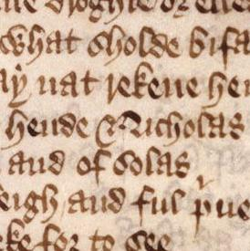

Soy profesor asociado del [Departamento de Literatura](https://artehum.uniandes.edu.co/pregrado/lite/) de la [Universidad de los Andes](https://uniandes.edu.co/), en Bogotá, Colombia, y actualmente dirijo el Departamento. Enseño e investigo sobre obras y autores clásicos y medievales de la tradición occidental (latina). Soy también un defensor de las [humanidades digitales](https://es.wikipedia.org/wiki/Humanidades_digitales).

Me doctoré (DPhil) en Filosofía en el Balliol College de la Universidad de Oxford (2014), con una tesis sobre la lógica y la semántica del filósofo del siglo XIV [Guillermo de Ockham](https://es.wikipedia.org/wiki/Guillermo_de_Ockham).

Soy editor adjunto y asesor técnico de la [edición digital en línea de la *Ordinatio* de Wodeham](https://scta.lombardpress.org/text?resourceid=http%3A%2F%2Fscta.info%2Fresource%2Fwodehamordinatio), que dirige el [profesor Jeffrey C. Witt](https://jeffreycwitt.com/).
También soy coeditor de [Programming Historian en español](https://programminghistorian.org/es/).

Mi página en Academia está [aquí](https://uniandes.academia.edu/NicolasVaughan).

Me entusiasma el [lenguaje de programación Python](https://www.python.org/), y también [LaTeX](https://www.latex-project.org/), el sistema de composición de documentos y lenguaje de marcado.
Mis programas, mis scripts y las herramientas que uso están en la página [Código](/es/programacion/).

Como se ve, defiendo el software libre y la publicación en acceso abierto.
