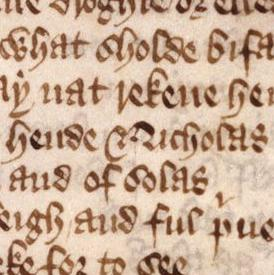

Professor associatus sum in [Departamento Litterarum](https://artehum.uniandes.edu.co/pregrado/lite/) [Universitatis de los Andes](https://uniandes.edu.co/), Bogotá, in Columbia, cuius Departamenti nunc prefectus sum. Docendo et inquirendo circa opera et auctores antiquos et medii evi traditionis occidentalis, scilicet Latine, versor. [Humanitates digitales](https://la.wikipedia.org/wiki/Humanitates_digitales) quoque defendo.

Gradum doctoris (DPhil) in philosophia adeptus sum in Collegio Balliolensi Universitatis Oxoniensis (2014), dissertatione de logica et semantica [Guillelmi de Ockham](https://la.wikipedia.org/wiki/Guillelmus_de_Ockham), philosophi seculi XIV, conscripta.

Editor adiunctus et consiliarius technicus sum [editionis digitalis *Ordinationis* Ade de Wodeham in rete](https://scta.lombardpress.org/text?resourceid=http%3A%2F%2Fscta.info%2Fresource%2Fwodehamordinatio), quam [professor Jeffrey C. Witt](https://jeffreycwitt.com/) dirigit.
Coeditor quoque sum [Programming Historian en español](https://programminghistorian.org/es/).

Paginam meam in Academia [hic](https://uniandes.academia.edu/NicolasVaughan) invenies.

Lingue programmandi [Python](https://www.python.org/) valde faveo, necnon [LaTeX](https://www.latex-project.org/), systemati documentorum componendorum et lingue notationis.
Programmata mea, scripta et instrumenta quibus utor in pagina [Programmata](/la/programmata/) inveniuntur.

Ut vides, programmata apertis fontibus et scripta omnibus libere patentia defendo.
